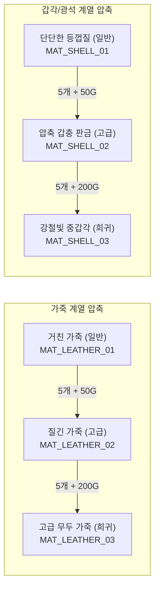

# 📊 1챕터 [아타말 개척지 & 바람의 숲] 세부 기획 및 데이터 테이블

《와일드 프론티어》 원작의 초반 진행 구조(초보 사냥터 ➔ 준보스 **'덕구'** 토벌 후 3대 직업 전직 ➔ 본격적인 재료 압축·룬 세팅 및 지역 우두머리 수렵)를 계승한 **1챕터 마스터 데이터 명세서**입니다.

---

## 1. 1챕터 몬스터 생태 도감 & 갈무리(Carving) 테이블

> **설계 핵심**
> - **소형(S) 몬스터**: 전용 먹이로 **펫 유혹(Taming)**이 가능하며, 주인공과 동등한 레벨까지 육성 시 고유 패시브가 개방됩니다.
> - **준보스 '광폭한 덕구'**: 원작 유저들의 영원한 추억인 초반 통곡의 벽이자 최고 인기 희귀 펫 '덕구'를 오마주한 프롤로그 졸업 보스입니다.
> - **오버킬/약점 처치 보너스**: 약점 속성 또는 워리어 풀차지/스카우터 치명타로 처치 시 시체가 반짝이며 **제작법(레시피북)** 및 **룬** 획득 확률이 대폭 상승합니다.

| 몬스터 ID | 이름 | 분류 / 크기 | Lv | HP | 공격력 | 방어력 | 약점 속성 | 야행성 | 갈무리 시간 | 주요 갈무리 전리품 (기본 확률 / 오버킬 보너스) | 펫 유혹 가능 (선호 먹이 / 개방 특성) |
| :--- | :--- | :--- | :---: | :---: | :---: | :---: | :---: | :---: | :---: | :--- | :--- |
| `MON_101` | **초원 뿔토끼** | 야수 / S (32×32) | 1 | 60 | 8 | 2 | 화염 | X | 1.0초 | • `거친 가죽` (80% / +15%) • `질긴 고기` (60% / +15%) • `[도안] 초보자 가죽 조끼` (8% / +10%) | **O** (`향긋한 풀잎` / **갈무리 속도 +15%**) |
| `MON_102` | **포자 독버섯** | 식물 / S (32×32) | 2 | 85 | 10 | 4 | 화염 | O | 1.0초 | • `형광 포자 가루` (75% / +15%) • `약초 뿌리` (50% / +10%) • `하급 화염의 룬(일반)` (5% / +8%) | **O** (`이슬 맺힌 이끼` / **초당 HP 1% 자연회복**) |
| `MON_103` | **가시 딱정벌레** | 갑충 / M (48×48) | 4 | 150 | 15 | 9 | 전격 | X | 1.2초 | • `단단한 등껍질` (75% / +15%) • `갑충의 턱뼈` (40% / +15%) • `[도안] 갑충 본 대검/쌍단검/방패` (6% / +12%) • `하급 가시의 룬(일반)` (6% / +8%) | X |
| `MON_104` | **바람갈기 늑대** | 야수 / M (48×48) | 6 | 220 | 24 | 7 | 냉기 | O | 1.3초 | • `거친 가죽` x2~3 (85% / +10%) • `날카로운 송곳니` (50% / +15%) • `하급 흡혈의 룬(일반)` (5% / +10%) | X |
| `MON_105` | **광폭한 덕구 (준보스)** | 야수 / S (32×32 특수) | 8 | 550 | 35 | 14 | 전격 | X | 1.8초 | • `덕구의 황금 털가죽` (100%) • `질긴 가죽` x2 (70% / +20%) • `[도안] 덕구 학살자의 무구 세트` (25% / +25%) • `중급 심판(가시)의 룬(고급)` (12% / +15%) | **O (희귀 2%)** (`특제 육포` / **플레이어 치명타율 +10% & 공격력 +8%**) |
| `MON_106` | **고대 수호목 엔트 (1챕터 보스)** | 식물·정령 / B (128×128) | 12 | 2,400 | 58 | 24 | 화염 | X | 2.5초 | • `고대목의 심장(보스 핵)` (100%) • `정령이 깃든 나뭇가지` (80% / +20%) • `[도안] 수호목의 영웅 무기 3종` (30% / +30%) • `희귀 전격/화염의 룬` (15% / +20%) | X (부위 파괴 가능) |

---

## 2. 재료 압축(Compression) & 변이(Mutation) 테이블

### 2.1 재료 압축 트리 (하위 재료 N개 ➔ 상위 재료 1개)
초반 사냥터에서 대량으로 얻는 하위 재료도 버리지 않고 상위 장비 재료로 압축해 끝까지 활용할 수 있습니다.

| 원본 재료 ID | 원본 재료명 (등급) | 필요 개수 | 압축 비용 | 압축 결과 재료 ID | 압축 결과 재료명 (등급) | 주요 사용처 |
| :--- | :--- | :---: | :---: | :--- | :--- | :--- |
| `MAT_LEATHER_01` | 거친 가죽 (일반) | 5개 | 50 G | `MAT_LEATHER_02` | **질긴 가죽 (고급)** | 1챕터 중반 방어구 및 스카우터 장비 제작 |
| `MAT_LEATHER_02` | 질긴 가죽 (고급) | 5개 | 200 G | `MAT_LEATHER_03` | **고급 무두 가죽 (희귀)** | 1챕터 보스급 장비 및 재료 변이 베이스 |
| `MAT_SHELL_01` | 단단한 등껍질 (일반) | 5개 | 50 G | `MAT_SHELL_02` | **압축 갑충 판금 (고급)** | 워리어 대검 및 가디언 방패 제작 |
| `MAT_SHELL_02` | 압축 갑충 판금 (고급) | 5개 | 200 G | `MAT_SHELL_03` | **강철빛 중갑각 (희귀)** | 가디언 반사 갑옷 및 고등급 무기 제작 |
| `MAT_SPORE_01` | 형광 포자 가루 (일반) | 4개 | 40 G | `MAT_SPORE_02` | **농축 마력 포자 (고급)** | 재료 변이 촉매 및 룬 합성 재료 |

### 2.2 재료 변이 (Mutation) 레시피
서로 다른 생태계의 재료를 조합하여 일반 채집/사냥으로는 얻을 수 없는 특수 재료를 연성합니다. **대성공(15%)** 시 한 단계 높은 영웅 등급 재료를 획득합니다.

| 변이 레시피 ID | 투입 재료 1 | 투입 재료 2 | 촉매 재료 | 비용 | 기본 결과물 (희귀) | ★대성공 결과물 (영웅, 15%) |
| :--- | :--- | :--- | :--- | :---: | :--- | :--- |
| `REC_MUT_01` | `질긴 가죽` ×2 | `단단한 등껍질` ×2 | `농축 마력 포자` ×1 | 150 G | **변이된 비늘 가죽** (`MAT_MUT_SCALE`) | **용린화(龍鱗化) 가죽** (`MAT_MUT_DRAGONSCALE`) |
| `REC_MUT_02` | `갑충의 턱뼈` ×2 | `날카로운 송곳니` ×2 | `농축 마력 포자` ×1 | 150 G | **맹독성 이빨 결정** (`MAT_MUT_FANG`) | **심연의 관통 송곳니** (`MAT_MUT_ABYSSFANG`) |

---

## 3. 1챕터 장비 제작 & 모닥불 캠프 요리 레시피

### 3.1 클래스별 핵심 장비 제작 레시피
| 레시피 ID | 제작 아이템명 | 클래스 / 부위 | 등급 | 요구 재료 | 핵심 스탯 및 특수 옵션 |
| :--- | :--- | :---: | :---: | :--- | :--- |
| `REC_EQ_W01` | **갑충 파쇄 대검** | 워리어 / 양손검 | 고급 | `압축 갑충 판금`×2, `갑충의 턱뼈`×3, `거친 가죽`×2 | 공격력 +28, 룬 슬롯 2개 (차지 공격 범위 +15%) |
| `REC_EQ_S01` | **바람이빨 쌍단검** | 스카우터 / 쌍검 | 고급 | `날카로운 송곳니`×4, `질긴 가죽`×2, `형광 포자 가루`×2 | 공격력 +20, 치명타율 +12%, 회피율 +8%, 룬 슬롯 2개 |
| `REC_EQ_G01` | **가시 등껍질 방패검** | 가디언 / 검+방패 | 고급 | `압축 갑충 판금`×3, `단단한 등껍질`×4, `거친 가죽`×2 | 공격력 +16, 방어력 +15, 회피율 +6%, **기본 반사 피해 +20%**, 룬 슬롯 2개 |
| `REC_EQ_B01` | **덕구 학살자의 견갑** | 공용 / 갑옷 | 희귀 | `덕구의 황금 털가죽`×1, `변이된 비늘 가죽`×1, `질긴 가죽`×3 | 방어력 +22, 최대 HP +120, 치명타 피해 +15%, 룬 슬롯 3개 |
| `REC_EQ_BOSS` | **고대 수호목의 대검/쌍검/방패** | 클래스별 / 무기 | 영웅 | `고대목의 심장`×1, `정령이 깃든 나뭇가지`×3, `강철빛 중갑각`×2 | 공격력 +55 (클래스별 특화), 룬 슬롯 3개, 화염/전격 발동률 +10% |

### 3.2 모닥불 캠프 요리 & 테이밍 먹이 레시피
| 레시피 ID | 요리/아이템명 | 분류 | 요구 재료 | 효과 (지속 시간) |
| :--- | :--- | :---: | :--- | :--- |
| `REC_COOK_01` | **모닥불 숯불구이 꼬치** | 캠프 요리 | `질긴 고기`×2, `약초 뿌리`×1 | 즉시 HP 40% 회복 + 5분간 공격력 +10% |
| `REC_COOK_02` | **사냥꾼의 행운 포자 스프** | 캠프 요리 | `형광 포자 가루`×2, `질긴 고기`×1 | 5분간 **시체 갈무리 희귀 재료 획득률 +15%** & 야간 시야 확장 |
| `REC_BAIT_01` | **덕구가 좋아하는 특제 육포** | 펫 유혹 먹이 | `질긴 고기`×3, `농축 마력 포자`×1 | 준보스 **'광폭한 덕구'** 및 야수형 소형 몬스터 테이밍 전용 먹이 |

---

## 4. 3대 클래스 스킬 & 5단계 룬(Rune) 밸런스 테이블

### 4.1 클래스별 핵심 액티브/패시브 스킬 명세
| 클래스 | 스킬명 | 구분 | 쿨타임 | 메커니즘 및 픽셀 연출 상세 |
| :--- | :--- | :---: | :---: | :--- |
| **공통 보조** | `견제 사격 (Sub-Gun)` | 액티브 | 4.0초 | 전방 직선상의 적에게 권총/화승총 사격(공격력의 90%). 원거리 어그로 끌기 및 장착된 룬 상태이상(전격/냉기 등) 원거리 묻히기 용도. |
| **워리어** | `차지 스매시 (Charge)` | 기본 홀드 | 없음 | 공격 버튼 홀드 시간에 비례해 몸 주변에 붉은 도트 오라가 모이며, 완충(1.2초) 시 **250% 광역 대미지 + 높은 경직 및 오버킬 판정**. |
| **워리어** | `대지 돌파 (Breakthrough)` | 액티브 | 7.0초 | 대검을 앞세워 전방으로 돌진하며 경로상의 몬스터를 밀쳐내고 **180%×2타 피해**. 보스 패턴 이탈 및 몰이 사냥 핵심기. |
| **스카우터** | `그림자 기습 (Backstab)` | 액티브 | 5.0초 | 대상 몬스터의 등 뒤로 순간 스텝 이동하며 쌍단검으로 베어 **210% 피해 (후방 적중 시 100% 치명타 발동)**. |
| **스카우터** | `질풍 난무 (Blade Flurry)` | 액티브 | 8.0초 | 1.2초간 전방을 6회 고속 연타(타당 45% 피해). 타수마다 **흡혈/화염/전격 룬 발동 판정이 개별 적용**되어 룬 시너지 극대화. |
| **가디언** | `가시 갑옷 (Thorns Aura)` | 패시브/버프 | 상시 | 원작 '반사 탱커'의 핵심. 피격 시뿐만 아니라 **공격을 회피(Evasion)했을 때도 적에게 공격력의 80% + 가시 룬 계수만큼 반사 피해**를 입힘. |
| **가디언** | `실드 스핀 (Shield Spin)` | 액티브 | 6.5초 | 방패를 두르고 팽이처럼 회전하며 주변 적에게 **5회 타격(타당 65% 피해) + 회전 중 받는 피해 50% 감소**. |

### 4.2 5단계 룬(Rune) 등급별 수치 테이블
하위 룬 3개를 조합하여 상위 등급 룬 1개로 승급할 수 있습니다 (`일반 ➔ 고급 ➔ 희귀 ➔ 영웅 ➔ 전설`).

| 룬 종류 | 발동 조건 | 일반 (Common) | 고급 (Uncommon) | 희귀 (Rare) | 영웅 (Epic) | 전설 (Legendary) | 추천 시너지 클래스 |
| :--- | :--- | :---: | :---: | :---: | :---: | :---: | :--- |
| 🔥 **화염의 룬** | 타격 시 확률 발동 (4초간 5틱 화상) | 확률 15% 틱당 6% 딜 | 확률 20% 틱당 8% 딜 | 확률 25% 틱당 10% 딜 | 확률 30% 틱당 13% 딜 | 확률 35% 틱당 16% 딜 | **워리어** (한방 대미지가 클수록 화상 틱 대미지 폭증) |
| ⚡ **전격의 룬** | 타격 시 확률 발동 (4초간 적 공/방 감소) | 확률 15% 공/방 -15% | 확률 18% 공/방 -22% | 확률 22% 공/방 -30% | 확률 26% 공/방 -40% | 확률 30% **공/방 -50%** | **전 클래스 보스전 필수** (거대 보스 공격력/방어력 반토막) |
| ❄️ **냉기의 룬** | 타격 시 확률 발동 (4초간 이속/공속 둔화) | 확률 20% 둔화 20% | 확률 25% 둔화 28% | 확률 30% 둔화 35% | 확률 35% 둔화 42% | 확률 40% 둔화 50% | **스카우터** (보스 패턴 둔화 후 안정적인 백어택) |
| 🩸 **흡혈의 룬** | 타격 시 확률 발동 (피해량 비례 HP 회복) | 확률 15% 흡혈 4% | 확률 18% 흡혈 6% | 확률 22% 흡혈 8% | 확률 26% 흡혈 11% | 확률 30% 흡혈 15% | **스카우터 / 가디언** (물약 소모 없는 무한 사냥 유지력) |
| 🛡️ **심판(가시)의 룬** | 피격 또는 **회피 성공 시** 상시 반사 | 반사 계수 +40% | 반사 계수 +70% | 반사 계수 +110% | 반사 계수 +160% | 반사 계수 **+220%** | **가디언 (회피 반사 탱커)** (회피 세팅과 결합해 노포션 보스 솔로잉) |
